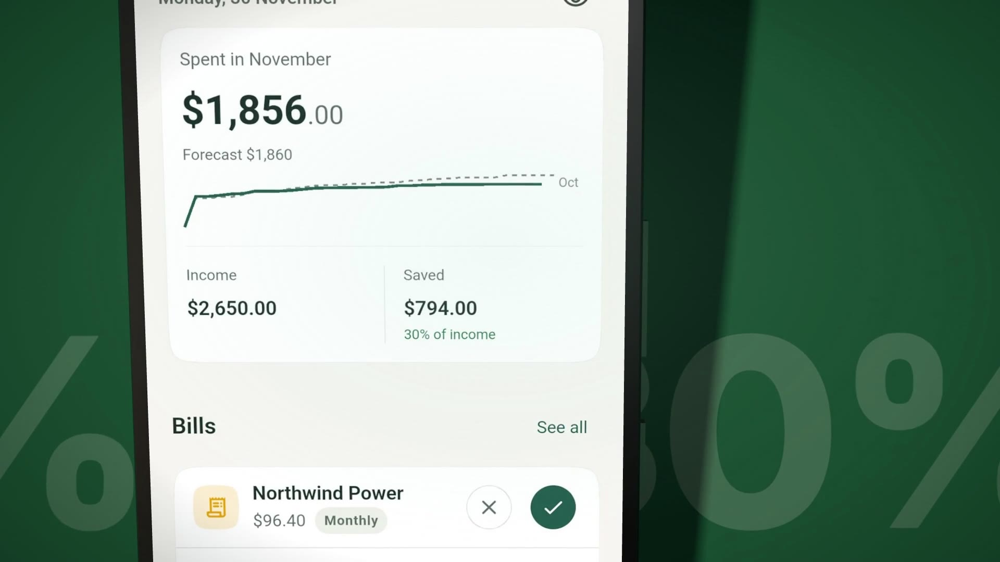
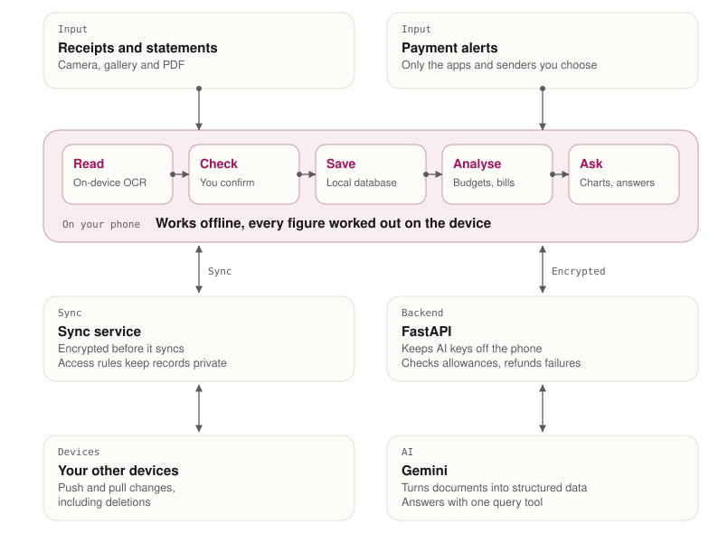

<h1 align="center">SnapLedger</h1>

<b>A personal-finance app that scans receipts, imports statements, suggests budgets and answers questions about your money.</b>

  
  
  

> [!NOTE]
> This is a showcase repository. SnapLedger is a commercial product, so the source code is private. I'm happy to walk through the code in an interview.

## Demo

**[Watch the demo](https://www.pranavguptachummun.com/work/snapledger/#demo)**. A phone scans a receipt, imports a bank statement, sets budgets and answers where to spend less. Two overlapping subscriptions are paused, the savings rate rises from 16% to 30%, and the app logs a bank alert before hiding every amount.

## Problem

Tracking money means turning receipts, statements and payment alerts into records you can trust, and most people give up long before that pays off. Even with good records, it's hard to see where the money really goes, like the subscriptions you stopped noticing months ago. I wanted an app that does the tedious part for you, then helps you decide what to change.

## What I built

SnapLedger is a personal-finance app for Android and iOS, currently in closed beta on Google Play. Snap a receipt or import a bank statement and it becomes transactions you can check before saving. From there, it suggests budgets from your real spending, finds subscriptions you may have forgotten, and lets you ask questions about your money in plain language.

## Architecture

<picture>
  <source media="(prefers-color-scheme: dark)" srcset="docs/architecture-dark.svg">
  
</picture>

- **Offline first.** Everyday use runs from a local database, so the app keeps working without a connection. A sync service pushes and pulls changes between devices, including deletions.
- **Private by design.** Financial details are encrypted before they sync, and access rules keep each person's records to themselves.
- **A backend that guards the AI.** It keeps AI keys off the phone, checks each person's allowance and refunds failed requests. Documents and questions travel through an extra layer of encryption, so a tunnel in between only ever sees ciphertext.
- **OCR first, AI second.** Receipts go through on-device text recognition first, then AI turns them into structured data, including PDFs.
- **The AI never does the maths.** The app works out every figure on the device, using the same logic as the rest of the app. The AI gets a summary of your finances and one general query tool whose filters, groupings and measures combine to answer most questions. Charts come from a few fixed templates, so they stay readable whatever you ask.
- **Payment alerts stay on the phone.** Bank alerts are read on the device, only from the apps and senders you choose. Raw messages never upload, and each payment waits for you to confirm it.

## Key features

- **Scan receipts.** Point the camera at a receipt and check the details before saving.
- **Import statements.** Turn a bank statement into sorted transactions, including PDFs.
- **Suggested budgets.** Start from your last three months and see what's left in each category.
- **Ask anything.** Type a question and get an answer, with a chart when it helps.
- **Subscription insights.** See the yearly cost, price rises and services that overlap.
- **Payment capture.** Bank alerts on Android and Apple Pay on iPhone become drafts for you to confirm.
- **Works offline.** Everyday use never waits for a network connection.
- **Private by design.** Your data is encrypted, with an app lock and one tap to hide amounts.

## Quality and testing

The repository has 186 Flutter test files, 33 backend test files and 12 end-to-end flows, covering database persistence, sync, scanning, budgets and the assistant.

CI runs formatting and static analysis, then tests with coverage, followed by Android and iOS build jobs. Firestore rules enforce user-scoped access. The Google Play closed beta gives me a place to test the app with real users before a wider release.

## Tech stack

Flutter, Riverpod, Drift and SQLite, FastAPI, Firebase, ML Kit OCR, Gemini

---

Built by [Pranav Gupta Chummun](https://www.pranavguptachummun.com). More of my work is on my [portfolio](https://www.pranavguptachummun.com) and [GitHub profile](https://github.com/pran-gc).
